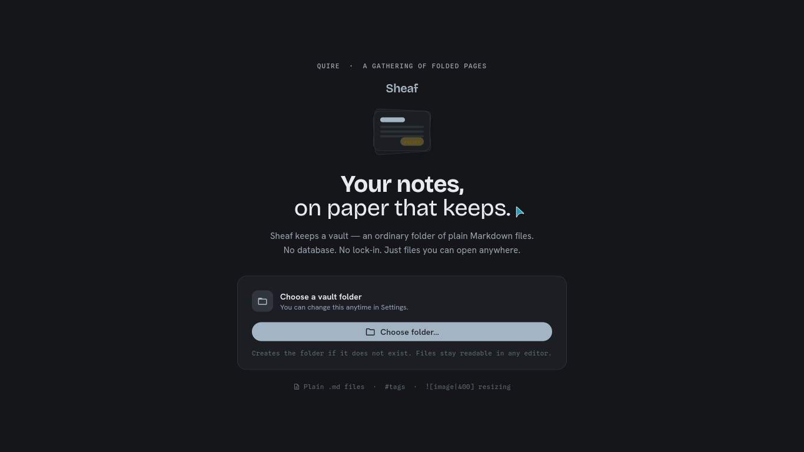
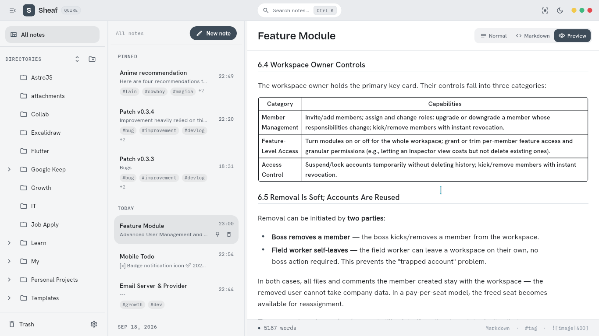
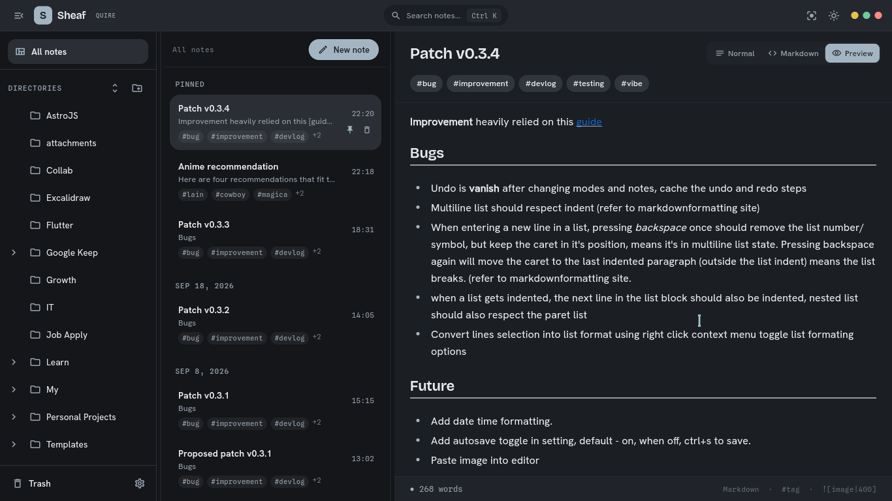
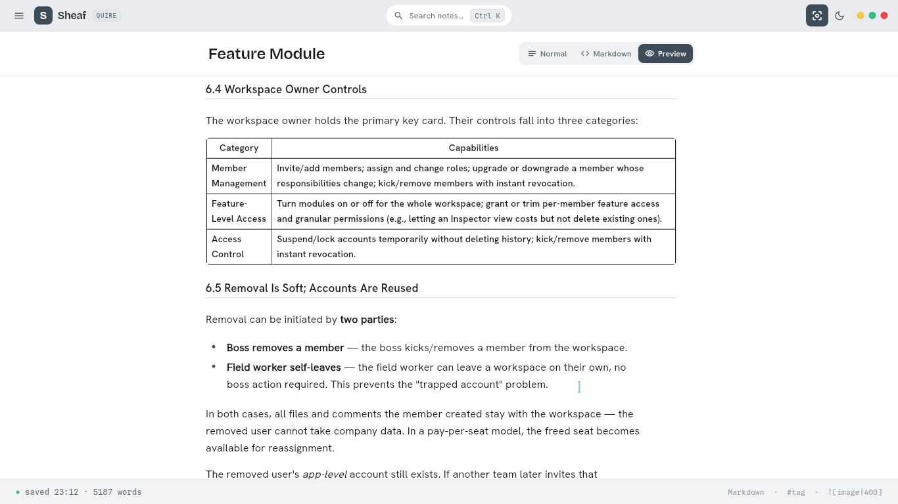
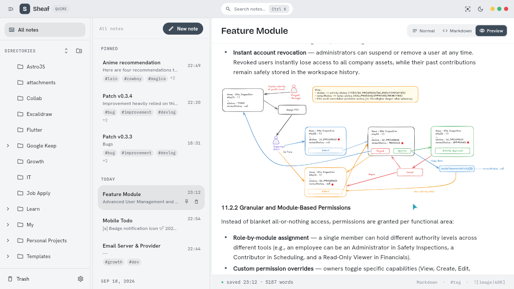
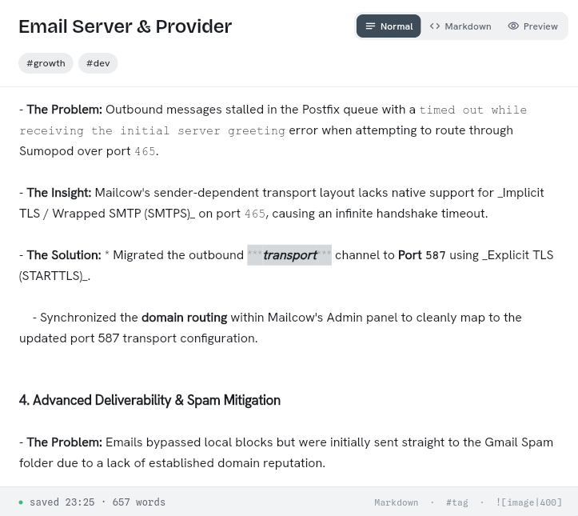
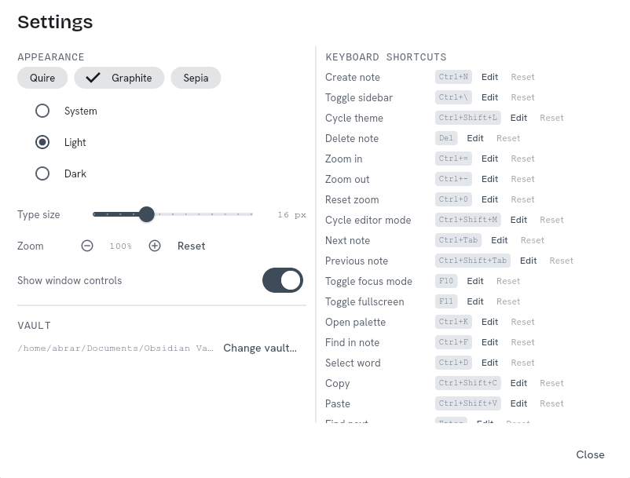

# Sheaf
[](https://github.com/AbrarAbe/sheaf/actions/workflows/release.yml)

A local-first Markdown notes desk for the Linux desktop. Your vaults are just
folders of plain `.md` files — no database, no lock-in. Add multiple vault
directories in Settings; notes merge newest-first. Built with Flutter + GTK,
shipped as a self-contained tarball or a portable AppImage.


</br>

<table align="center">
    <tr>
        <td></td>
        <td></td>
    </tr>
    <tr>
        <td align="center" width=400>Light Mode</td>
        <td align="center" width=400>Dark Mode</td>
    </tr>
</table>

## Features

### Vaults & files

- **Multi-vaults** — add multiple vault folders in Settings; notes merge
  newest-first, scoped by `vaultIndex`/`folderPath`. Each vault keeps its own
  `.trash/`, `.attachments/`, and `.sheaf/meta.json` pins.
- **Plain-file vaults** — notes are standard Markdown you can open anywhere.
  Folder create/rename/delete included; dot-directories are left alone.
- **Images** — drag & drop images into `<vault>/.attachments/` and reference
  them relatively, with Obsidian-compatible width syntax
  ``. Existing `attachments/` folders migrate
  to `.attachments/` on first vault open. A toolbar insert-image button is not
  wired yet — drag & drop is the way to add images.
- **Auto-refresh** — external changes to the vault appear live via a file
  watcher.

### Workspace & navigation

- **Three-pane shell** — sidebar · note list · editor, adapting across wide
  (≥1120 px), compact (720–1119 px), and stacked (<720 px) layouts. The
  sidebar is user-owned in every tier (toggle button or `Ctrl+\`), persists
  per tier, and becomes an overlay drawer when stacked. Draggable dividers
  with sane clamps.
- **Deliberate note creation** — `Ctrl+N`, the list-pane button, the scaffold
  context menu, the empty state, and the stack shell all open a two-field modal
  (name defaults to `Untitled`, location defaults to the current directory,
  chosen from the folder tree), so no note is created until you confirm
  (`Enter` accepts the defaults, `Esc` cancels). A folder's context menu adds
  `New note inside`, and the unfiltered note list labels each row with its
  parent folder (`Vault root` for top-level notes). A `NewNotePicker` setting
  (`builtin` default / `system`) swaps the modal for the OS Save dialog.
- **Fast retrieval** — pinned notes float in a PINNED section; the rest is
  day-grouped, recent-first, with instant filtering across title + body and
  title-priority ranking.
- **Quick-switcher** — `Ctrl+K` (or the header search pill) jumps to any note
  across vaults; an empty query lists notes newest-first, so the first row is
  always what you touched last.
- **Nested folders** — the folder tree renders recursively with chevron
  expand/collapse; indent per depth; a collapsed state hides a subtree without
  selecting it.
- **Sticky DIRECTORIES header** — the FOLDERS header (DIRECTORIES on Linux)
  stays pinned above the scrollable folder list.
- **In-editor tags** — `#tag` chips live inside the editor column under the
  title and scroll with content; in edit modes a tap copies `#tag ` at the
  caret, and in Preview a tap scrolls the rendered preview to that tag.

### Editing

- **Three editor modes** — Normal renders formatting live with markers hidden
  until touched; Markdown shows raw monospace source; Preview renders the GFM
  subset read-only. Autosave (~1 s) behaves identically everywhere.
- **Type-first editing** — opening a note (list or `Ctrl+K`) drops the caret
  straight into the body; the title saves on blur (click away, `Tab`, or
  switching notes) without pressing Enter; caret and scroll are remembered per
  note across switches. Indentation only nests lists — never a code block — so
  use fenced code blocks for code. A note's title is always its file name; a
  `# Heading` in the body never overrides it.
- **Keyboard-complete editing** — `Ctrl+B/I/U` toggle bold/italic/underline
  (combinable, nesting `***`/`**<u>`; word-aware Unicode `café naïve` at a bare
  caret), Enter continues lists (`- `, `* `, `1. `, `- [ ] `),
  `Tab`/`Shift+Tab` indent/outdent the line or selection by four spaces,
  `Ctrl+F` finds inside the note (recomputes on edit), `Ctrl+D` selects word,
  `Ctrl+Shift+C/V` copy/paste, `Ctrl+Tab` cycles notes. See the shortcuts table
  below.
- **Sticky state** — undo/redo history is kept per note, so `Ctrl+Z` still
  works after switching notes or cycling Normal/Markdown/Preview. The preview
  remembers its scroll position across mode switches, with a go-to-top button
  that fades in once you scroll down. Each mode keeps its own scroll
  controller, so switching modes no longer flashes the top of the note before
  landing on the cached position.
- **Tight selection & scrollbar** — multi-line selection hugs glyphs
  (`BoxWidthStyle.tight`); the interactive scrollbar shows a hand cursor and a
  padded gutter (`right 18/24`) without covering text.

### Preview & appearance

- **Live preview** — GFM subset (headings, emphasis, lists, task lists,
  quotes, fenced code, links, tables, `<u>` underline) rendered with your
  chosen theme world; links use the theme accent; `Ctrl+F` finds inside the
  rendered preview and `Enter`/`Shift+Enter` step through matches; System mode
  follows your desktop.
- **Theme worlds & type controls** — Quire, Graphite, and Sepia color sets ×
  System/Light/Dark; app-wide zoom (`Ctrl+=/-/0`); editor type size 12–24 px.
- **Custom shortcuts** — remap non-formatting shortcuts in Settings (Keyboard
  Shortcuts); `Ctrl+B/I/U` stay reserved for formatting.
- **Focus & fullscreen** — `F10` collapses to an editor-only surface; `F11`
  true native fullscreen; optional traffic-light window controls in the header
  (hideable in settings).

### Organization

- **Trash** — deletions ask first (note, folder, and delete-forever each show a
  confirmation dialog; folder delete warns the whole tree moves), then land in
  `.trash/`; restore returns notes to their original folder with a toast, or
  delete forever; each entry shows when it was trashed.
- **Note info** — the note context menu has an Info entry showing file name,
  full path, created/modified dates, and word/character counts.

### Screenshots

<table align="center">
  <tr>
    <td><br></td>
    <td><br></td>
  </tr>
  <tr>
    <td align="center">Live preview</td>
    <td align="center">Image support</td>
  </tr>
</table>
<table align="center">
  <tr>
    <td align="center"><br></td>
  </tr>
  <tr>
    <td align="center">Format ready</td>
  </tr>
</table>

## Keyboard shortcuts

| Action | Keys |
|---|---|
| New note | `Ctrl+N` |
| Move selection | `↑` / `↓` |
| Open selected | `Enter` |
| Delete selected | `Del` (confirm dialog, corner toast with Undo) |
| Find/filter list | `Ctrl+F`, dismiss with `Esc` |
| Show/hide sidebar | `Ctrl+\` |
| Cycle theme mode | `Ctrl+Shift+L` |
| Next/previous note | `Ctrl+Tab` / `Ctrl+Shift+Tab` |
| Bold / italic / underline | `Ctrl+B` / `Ctrl+I` / `Ctrl+U` |
| Select word | `Ctrl+D` |
| Find in note | `Ctrl+F` in the editor or preview, `Esc` closes |
| Copy/paste (terminal-style) | `Ctrl+Shift+C` / `Ctrl+Shift+V` |
| Undo / redo | `Ctrl+Z` / `Ctrl+Shift+Z` |
| Cycle editor mode | `Ctrl+Shift+M` |
| Indent / outdent line(s) | `Tab` / `Shift+Tab` |
| Zoom | `Ctrl+=` / `Ctrl+-`, reset `Ctrl+0` |
| Focus mode | `F10` |
| Fullscreen | `F11` |

> Shortcuts can be customized in the settings panel
<table>
    <tr>
        <td align="center">
            <br>
            <em>More customizations coming soon</em>
        </td>
    </tr>
</table>

## Install (Linux x64)

Sheaf ships two ways — a portable AppImage you run as-is (recommended), or a
tarball you install once. The AppImage needs no install: just download and
run. The tarball uses a one-liner installer that resolves the latest version
from GitHub, so you never type one.

### Option 1 — Portable (AppImage) *(recommended)*

No install needed. Download the `sheaf-*-linux-x64.AppImage` from
[Releases](https://github.com/AbrarAbe/sheaf/releases), make it executable,
and run it:

```bash
chmod +x sheaf-*-linux-x64.AppImage   # make it executable
./sheaf-*-linux-x64.AppImage          # run it
```

GTK 3 is the only runtime expectation, and it ships with virtually every
desktop distribution.

> **Keep it updated with Gear Lever** — the AppImage embeds its GitHub
> release information, so [Gear Lever](https://gearlever.mijorus.it) can
> update it in place, including zsync delta downloads. Install it once with
> `flatpak install flathub it.mijorus.gearlever`, then add the AppImage to
> Gear Lever and let it handle updates from the app menu.

### Option 2 — Install (tarball)

The one-liner installer downloads the latest tarball, extracts it to
`~/.local/share/sheaf`, links the binary into `~/.local/bin`, and creates a
desktop entry:

```bash
curl -fsSL https://raw.githubusercontent.com/AbrarAbe/sheaf/main/install.sh | bash
```

To update, re-run the same command. The installer detects an existing
`~/.local/share/sheaf` and overwrites it ("Existing install ... — overwriting"),
so the binary, symlink, and desktop entry always point at the newest release —
no cleanup needed.

> [!NOTE]
> There is no distro package yet (`.deb`, Flatpak, or AUR), so this re-run is
> the update path. If you'd rather have automatic updates, use the AppImage
> with Gear Lever instead.

Options include `--version vX.Y.Z` to pin a release, `--prefix`/`--bindir` to
change the install locations, `--no-desktop` to skip the desktop entry,
`--uninstall` to remove everything, and `--help` for the full list. The script
soft-checks for GTK 3 and warns if it's missing.

## Uninstall

**Tarball install** — run the installer's uninstall mode:

```bash
curl -fsSL https://raw.githubusercontent.com/AbrarAbe/sheaf/main/install.sh | bash -s -- --uninstall
```

This removes `~/.local/share/sheaf`, the `~/.local/bin/sheaf` link, and the
desktop entry. If you installed to a custom location, pass the same
`--prefix`/`--bindir` you used to install.

**AppImage** — it's a single file, so just delete it. If you added it to Gear
Lever, remove it there first.

## Build from source

Prerequisites: a Flutter SDK on the **beta** channel (see the `sdk:` constraint
in `pubspec.yaml`), plus the standard Linux desktop build tools:

```
sudo apt-get install clang cmake ninja-build pkg-config libgtk-3-dev liblzma-dev
```

```
flutter pub get
flutter run -d linux            # development
flutter build linux --release   # produces build/linux/x64/release/bundle
```

To package that bundle as a portable AppImage:

```
./scripts/build_appimage.sh                      # produces Sheaf.AppImage
./scripts/build_appimage.sh sheaf-v0.3.6-linux-x64.AppImage   # custom name
```

The script bundles GTK into the AppImage and emits a `.zsync` file for delta
updates (consumed by Gear Lever). It needs `zsyncmake` on `PATH` to generate
the `.zsync`.

## Project docs

- [`docs/spec.md`](docs/spec.md) — what Sheaf is (living spec)
- [`docs/design/`](docs/design) — design docs (theming, layout, voice)
- [`docs/adr/`](docs/adr) — architecture decision records
- [`docs/plan/plan_v0.1.md`](docs/plan/plan_v0.1.md) — v0.1 implementation plan
- [`docs/plan/plan_v0.2.md`](docs/plan/plan_v0.2.md) — v0.2 implementation plan (editor, modes, pinning, appearance)
- [`docs/plan/plan_v0.3.md`](docs/plan/plan_v0.3.md) — v0.3 implementation plan (polish & multi-directory)
- [`docs/plan/plan_v0.3.1.md`](docs/plan/plan_v0.3.1.md) — v0.3.1 implementation plan (paper cuts)
- [`docs/plan/plan_v0.3.2.md`](docs/plan/plan_v0.3.2.md) — v0.3.2 implementation plan (no surprises)
- [`docs/plan/plan_v0.3.3.md`](docs/plan/plan_v0.3.3.md) — v0.3.3 implementation plan (type-first)
- [`docs/plan/plan_v0.3.4.md`](docs/plan/plan_v0.3.4.md) — v0.3.4 implementation plan (sticky state)
- [`docs/plan/plan_v0.3.5.md`](docs/plan/plan_v0.3.5.md) — v0.3.5 implementation plan (steady)
- [`docs/plan/plan_v0.3.6.md`](docs/plan/plan_v0.3.6.md) — v0.3.6 implementation plan (deliberate)

## Contributing

> [!NOTE]
> **sheaf** is not open to outside contributions yet — it's still in early, fast-moving development and the codebase changes day to day. Once the doors open, this section will spell out the process. Until then, there are still two useful ways to help:

*   **Reporting Bugs** : If you find any bugs or issues, please open an issue on the GitHub repository. Provide a clear description of the bug, steps to reproduce it, and any relevant error messages.
*   **Suggesting Features** : Have an idea for a new feature or improvement? Feel free to open a discussion to suggest it. Describe your idea and why you think it would be valuable.

**Submitting Pull Requests** : On hold for now — please hold off on opening a pull request until contribution guidelines land. When they do, the expectation will be the same as it is today: fork the repository, keep your changes focused and well-commented, follow [conventional commits guidelines](https://www.conventionalcommits.org/en/v1.0.0/) and follow general Flutter coding conventions.

We appreciate your help in making this project even better!

## License

This project is open-source and is distributed under the [GPL-3.0 License](LICENSE). See the `LICENSE` file for details.

## Contact

*   <abrar.abe01@gmail.com>
*   [GitHub](https://github.com/AbrarAbe)